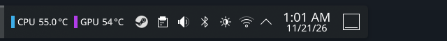

# plasma-sensors

[English](README.md)

Mostrá las temperaturas de tu PC en el panel de KDE Plasma 6, con un solo
comando.



KDE Plasma ya trae un widget de Monitor del sistema que puede mostrar cualquier
sensor, pero para llegar hay un par de pasos que no son obvios:

- **Muchas veces faltan los sensores de la placa madre.** El chip que lee los
  ventiladores y las temperaturas de la placa (un chip Super I/O como Nuvoton
  NCT67xx o ITE IT87xx) necesita un driver del kernel que la mayoría de las
  distros, Bazzite incluida, no cargan solas. Sin él no ves ni las RPM de los
  ventiladores ni la temperatura del chipset.
- **Elegir los sensores a mano es tedioso.** Hay cientos, y muchos son entradas
  sin nada conectado que marcan 0 °C o 127 °C.

`plasma-sensors` hace las dos cosas:

1. Encuentra el driver del chip de sensores de tu placa, lo carga y lo deja
   configurado para que cargue en cada arranque.
2. Agrega al panel un widget de Monitor del sistema con la temperatura de la
   CPU y la GPU, y el resto en la ventana que se abre al hacer clic: uso de CPU
   y GPU, consumo de la GPU, temperatura del chipset y de la placa, cada disco
   NVMe, la RAM y los ventiladores que están girando.

Todo lo que hace queda registrado y `plasma-sensors uninstall` lo deshace.

Hecho en [Bazzite](https://bazzite.gg/) (edición KDE), funciona en cualquier
distro con KDE Plasma 6: Fedora KDE, Kubuntu, KDE neon, Arch, openSUSE…

## Instalación

Necesitás KDE Plasma 6, Python 3.9+, `lm_sensors` (`lm-sensors` en Debian y
Ubuntu) y `ksystemstats` (trae `kstatsviewer`). Bazzite y Fedora KDE ya los
tienen.

```bash
git clone https://github.com/sawady/plasma-sensors.git
cd plasma-sensors
./plasma-sensors detect     # muestra lo que encontró, no cambia nada
./plasma-sensors install
```

Cargar módulos del kernel necesita `sudo`, así que puede pedirte la
contraseña. Para ubicar el widget justo antes de la bandeja del sistema, Plasma
se reinicia una vez: la pantalla parpadea un momento.

Opciones:

| Opción | Qué hace |
| --- | --- |
| `--no-modules` | Saltea el paso del driver: solo agrega el widget. |
| `--no-widget` | Saltea el widget: solo configura el driver. |
| `--desktop` | Pone el widget en el escritorio en vez del panel. En pantallas OLED un widget fijo puede quemar la imagen; el panel es más seguro. |
| `--no-restart` | No reinicia Plasma. El widget queda al final del panel; movelo en el Modo de edición. |
| `--dry-run` | Muestra qué cambiaría y no cambia nada. |
| `--lang en\|es` | Idioma de los mensajes y de las etiquetas del widget. Por defecto sigue tu locale. |

Si corrés `install` de nuevo, reemplaza el widget que agregó antes, así que lo
podés volver a correr después de sumar un disco o una GPU.

## Personalizar

Clic derecho en el widget → *Configurar Sensores…*. Los sensores de arriba de
la lista son los que se ven en el panel; el resto aparece en el popup. Ahí
también podés cambiar el estilo (texto, gráfico de líneas, barras, grilla de
mini-gráficos).

## Desinstalar

```bash
./plasma-sensors uninstall
```

Saca el widget y `/etc/modules-load.d/plasma-sensors.conf`. El driver sigue
cargado hasta que reinicies. No toca drivers que hayas configurado vos.

## Qué cambia

- `/etc/modules-load.d/plasma-sensors.conf` (con `sudo`): los drivers que se
  cargan al arrancar. Solo los que encontraron un chip y que no estaban ya
  configurados.
- Tu panel de Plasma: un widget de Monitor del sistema, guardado en
  `~/.config/plasma-org.kde.plasma.desktop-appletsrc` como cualquier otro.
- `~/.local/state/plasma-sensors/state.json`: qué hizo, para `uninstall`.

## Cómo encuentra el driver

Prueba uno por uno los drivers Super I/O del kernel (`nct6775`, `it87`,
`nct6683`, `f71882fg`, `w83627ehf`) y se queda con el primero que encuentra un
chip. Estos drivers buscan su chip y no cargan si no está. Si uno carga pero no
agrega sensores, lo descarga. Después prueba los drivers de ASUS que suman
sensores en las placas compatibles (`asus_ec_sensors`, `asus_wmi_sensors`).

## Problemas comunes

**No encuentra el chip de la placa.** Corré `sudo sensors-detect` y leé el
resumen: conoce muchos más chips. Algunas placas (varios modelos de Gigabyte con
chips ITE nuevos) necesitan el
[driver it87 externo](https://github.com/frankcrawford/it87).

**`nct6775` falla con un conflicto de recursos ACPI** (en `sudo dmesg`).
Algunas placas reservan el chip para el firmware. La solución habitual es el
argumento del kernel `acpi_enforce_resources=lax`; informate sobre sus riesgos
antes de usarlo. En Bazzite: `rpm-ostree kargs --append=acpi_enforce_resources=lax`.

**Lecturas raras en `sensors`** (voltajes con `ALARM`, una temperatura de
127 °C, `intrusion ALARM`). Vienen de entradas sin nada conectado o de límites
en 0, y en general no significan nada. El widget las saltea.

**El widget no muestra la GPU.** KSystemStats lee las placas NVIDIA con
`nvidia-smi` y las AMD e Intel a través del kernel. Fijate que
`kstatsviewer --list | grep gpu` liste una temperatura.

## Licencia

[MIT](LICENSE)
